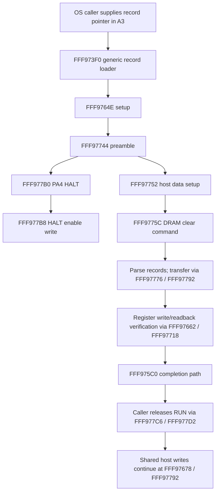

# ASR-10 OS 3.53 ES5510 loader disassembly and timing

## Scope and conclusion

This analysis uses the ROM-01 HALL load captured by `research/es5510-hall-load-boundary` and the start-project evidence at `research/asr10-ghidra-loader-analysis` (`d199d23`) and `research/asr10-hall-spr-rea-analysis` (`8b39889`). REA 6.9.0 and Ghidra 12.1.4 both operated. No existing OS 3.53 Ghidra project was found in the searched private analysis directories, so a new private project was created from private firmware copies. Original files and all decoded bytes remained outside Git.

The trace's loader PCs map directly into the interleaved 256 KiB boot ROM at base `FFF80000`; the 68000 code is present and can be decoded. The prior missing-instruction result had two causes: the earlier nominal-base import was the 195,584-byte floppy OS payload rather than the boot ROM, and even a correct boot-ROM import does not automatically discover every shared helper path. Trace-seeding those addresses in a disposable Ghidra project recovers the generic effect-record loader and helper functions. This confirms a common loader path, but the trace does not expose the HALL source pointer or a unique HALL wrapper. Two visible ROM wrappers pass tables that do not match the captured HALL image, so assigning either wrapper to HALL would be unsupported.

## Address map and decoding checks

The source boot ROM is a pair of 128 KiB byte lanes. Interleave is high byte then low byte, yielding 262,144 bytes. The private Ghidra program uses `68000:BE:32:default`, base `FFF80000`, one initialized read/write/execute block `FFF80000–FFFBFFFF`. The emulator selects a 68000 CPU and has a 24-bit address bus; the ROM is aliased at `00F80000`. For the trace's sign-extended runtime PCs, file offset is `PC - FFF80000` (e.g. `FFF973F0 -> 0x173F0`). All listed PCs are even aligned and fall in the executable ROM block. The initial reset vector points to low address `0000000C`; the MC68302 reset chip-select mapping aliases the ROM into that low window before chip-select setup. A single raw-binary import at the high runtime base cannot simultaneously model that low reset alias and high ROM window. The cold-start linkage is separately visible at the high ROM address `FFFB8E3E`.

The prior loader report's 195,584-byte OS payload at `FFF80000` is not the runtime ROM image. Its bytes at these PCs differ. Importing it at the ROM base can produce address-shaped but irrelevant code and cannot explain runtime execution. The new headless Ghidra script seeds known trace PCs/call targets, after which the instruction listing covers the previously absent helpers. It clears only the corresponding listing item in the private program before disassembly; it does not edit any original Ghidra project. The gap was analysis flow and incorrect artifact selection, not byte order, processor language, executable permission, or odd instruction alignment.

| Address / range | Verified role | Evidence / limitation |
|---|---|---|
| `FFF97346–FFF973DF` | Cold-start DSP initialization | REA decompilation; includes initial host setup and special-register access. |
| `FFF973F0` | Generic effect-record transfer and verification entry | Direct `JSR` destinations at `FFF97E32` and `FFF97F34`; seeded Ghidra decompilation. Input is caller-supplied A3. |
| `FFF97744–FFF9776C` | HALT/host setup and DRAM-clear command preamble | Trace PC `FFF9775C`; decoded bytes and decompilation. |
| `FFF9776E` | Loads host I/O base `FFFC3001`, returns | Used as helper by preamble. |
| `FFF97776–FFF977AE` | Shared host-port write and status polling | Trace commit PC `FFF97792`; also decoded from direct callers. |
| `FFF977B0–FFF977C4` | PA4 HALT helper | `FFF977B8` writes HALT enable `2` to `FFFC303F`. |
| `FFF977C6–FFF977DA` | PA4 RUN release helper | `FFF977C6` changes PA4; `FFF977D2` writes host control `1` to `FFFC3025`. |
| `FFF97662–FFF976B4` | DSP register write/readback retry helper | Trace data-latch PC `FFF97678`; calls host transfer and read helper. |
| `FFF97718–FFF97728` | Host register read helper | Static decode; used by register verification and post-RUN polling. |
| `FFF976FA–FFF97716` | Restore/poll/wait helper | Static decode. |
| `FFFB8E3E` onward | Startup routine containing cold-start call | Startup control-flow linkage; not the HALL selection caller. |

Function labels above are analyst labels for confirmed address ranges, not names recovered from firmware symbols. The generic loader's decompilation shows record parsing, transfer, and readback/verification passes. It recognizes record type/count/index fields. Some type-4 writes to special indices are masked or skipped during verification (including `F9`–`FB`); the code itself does not establish that a given input table is HALL. The cold-start function separately configures host serial routing (`0x48`) and initializes host-visible DSP state.

## Control flow

This diagram separates the generic loader from its caller. In the trace, HALT, DRAM clear, upload, RUN, and post-RUN writes all have matching decoded PCs. The specific A3 value/callsite used for the selected HALL record is unavailable in the event log. Static calls to `FFF973F0` were found at `FFF97E32` and `FFF97F34`; their pointers are `FFFA180C` and `FFFA15C3`. The first table begins with a 34-instruction record; the second contains an 89-count program record but does not match the captured HALL instruction bytes. They are therefore not identified here as the HALL caller/table. An indirect call or caller outside the boot-ROM window remains possible.

## HALL event correlation

The selector display at 26.114 s is not the load boundary. The trace evidence below is from the later HALL transaction; CPU cycles are the MC68302's 16 MHz counter and DSP frames are ES5510 `run_frame()` counters, not WAV frame numbers.

| Phase | Event / coordinate | Decoded operation |
|---|---|---|
| HALT/pipeline reset | event 87885, cycle 420614232, frame 854142, PC `FFF977B8` | Host accepts HALT. Emulator trace records pending MAC/ALU results and pipeline slots cleared and DOL count reset. Firmware HALT helper begins at `FFF977B0`. |
| Host clear setup | events 87891–87894, cycle 420614390, frame 854143, PC `FFF97756/FFF9775C` | Host data `F5=FFFF00`, then host control `2`; trace reports 1,048,576 16-bit DRAM words cleared. This is a separate host command after HALT. |
| Instruction transfer | first commit cycle 421228220, frame 855284, PC `FFF97792` | 89 distinct instruction words are committed, END at word 88. |
| Halted state upload | through RUN at frame 855972 | 342 GPR writes total: 256 GPR-only plus 86 paired with instruction commits; 86 of the 89 instruction commits have paired GPR initialization, and 3 are instruction-only. |
| RUN release | event 94095, cycle 421550288, frame 855972, PC `FFF977C6` | PA4 release. `FFF977D2` writes host control `1`. |
| First running frame | event 94098, cycle 421550328, frame 855973 | DSP_RUN; host serial mode `0x48`. At 31 voices the modeled frame rate is 29,761.895 Hz. |
| First input/output | event 94100, frame 855973 | First `AUDIO_PRE` has SER2R/SER2L input `-5875` (`0xE90D`); first output is on SER1 in that same frame. Snapshot marker event 94099 precedes AUDIO_PRE in log order. |
| First post-RUN host transfer | event 94103, cycle 421550922, frame 855973, PC `FFF97678`; commit at `FFF97792` | Firmware resumes host register traffic in the same DSP frame as RUN. |

The longer trace contains 213 post-RUN `GPR_COMMIT` events at `FFF97792` after the initial 342-commit halted load. They are firmware host writes, not part of the HALL initialization transaction. Their most frequent indices are `0x7F` (111 events), `0x7C` (37), and `0x7D` (37); the remainder are other register indices. The shorter replay-boundary capture records 87 ordered post-RUN updates in its bounded interval. This traffic is potentially relevant to standalone replay: replaying only the 89 program words and 342 halted register commits omits subsequent writes. Their exact semantic purpose is not proven by event addresses alone, so they should be reproduced as ordered host transactions rather than interpreted as DSP audio-side effects.

## SER2R/SER2L at frame 855973

The code establishes host serial setup in the cold-start path (`FFF97346`, including the `0x48` configuration write). The selected-HALL transaction has no halted host commit to SPR indices `EE` or `EF`. The captured first running frame does contain the input sample `0xE90D` in both SER2 lanes, and the output appears on SER1. The snapshot marker is before `AUDIO_PRE` in event order, while the saved serial values equal that first input. Thus code and trace support the serial route and identify the first relevant sample exactly, but do not determine whether the snapshot captured the just-latched sample or state immediately before the first DSP instruction. The 40 CPU-cycle interval from RUN host-control write (cycle 421550288 to DSP_RUN at 421550328), plus emulator scheduling, prevents stronger sub-frame timing claims. The physical ES5510 sampling edge is not measured.

The accompanying SPR reconciliation identifies the seven reconstructed-versus-captured differences: SER2R `EE`, SER2L `EF`, MACH `F3`, DIL `F4`, DBASE `F8`, SIGREG `F9`, and CCR `FA`. Those values and per-event write evidence are recorded in `ASR10-ES5510-SPR-state-reconciliation.md`. The generic loader code and trace show no missing HALL writes to `EE`, `EF`, `F3`, `F8`, `F9`, or `FA`; the trace has one `F4=0000FF` attempt (event 92332, cycle 421316334, frame 855448, PC `FFF97792`). Emulator register semantics treat F4 as memory configuration and derive DIL as a live latch, so that write is not a DIL initialization. The remaining values are consistent with retained/live state or capture timing in the emulator model. These implementation-derived semantics are corroborated in `src/es5510.cpp` and `third_party/trollfx_mame_es5510/mame_es5510_standalone.cpp`, not confirmed measurements of silicon.

## Reproduction and boundaries

`tools/ghidra/interleave_rom_pair.py` builds a high/low interleave into a new path outside the checkout and refuses to overwrite an output. `tools/ghidra/SeedAsr10TraceFlow.java` seeds trace-verified PCs in a private Ghidra project and writes listing/decompilation output to an explicit private path. Do not pass proprietary files, extracted instructions, captures, or decompiler output into Git. A headless Ghidra run against the private interleaved copy recovered the listed helpers; the REA 6.9.0/Ghidra 12.1.4 integration independently inspected/decompiled the same high ROM mapping. The `asr10-cli` 68000 disassembly was used as a second decoder check. The exact HALL A3 source pointer, physical-chip serial sampling edge, and semantic meaning of all post-RUN register updates remain open.
